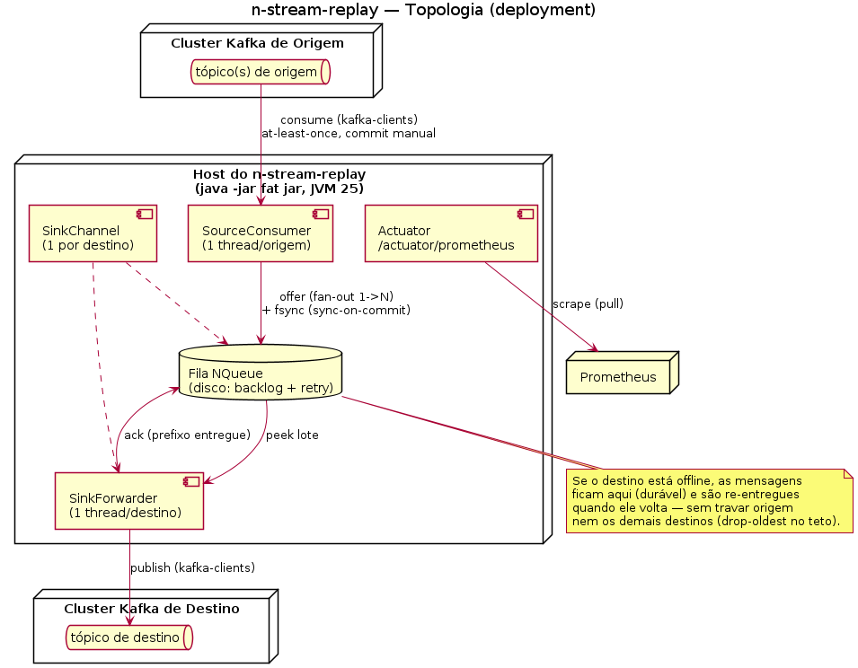

# n-stream-replay — Durable Apache Kafka Store-and-Forward Relay

[](https://github.com/nishisan-dev/n-stream-replay/releases)
[](LICENSE)


**A lightweight Kafka MirrorMaker 2 alternative for durable event forwarding, cross-cluster topic routing, and disconnected destinations.**

n-stream-replay is a **Java-based Kafka relay with disk-backed store-and-forward queues**. It consumes records from configured source topics, routes them to one or more Kafka destinations, and persists messages in an **independent durable queue per sink**. If a destination Kafka cluster goes offline, its backlog can be retried after recovery without blocking other destinations.

Choose it for **Kafka topic mirroring, fan-out, many-to-one routing, topic renaming, resilient cross-datacenter event distribution, and intermittent network connectivity**. It is **not a drop-in replacement** for every Apache Kafka MirrorMaker 2 feature: it does not synchronize consumer-group checkpoints, ACLs, or topic configurations.

**[Português (Brasil)](README.pt-BR.md)** · **[Architecture](docs/architecture.md)** · **[Complete configuration example](docs/usage-example.md)** · **[MirrorMaker 2 comparison](docs/mirrormaker-vs-n-stream-replay.md)** · **[Releases](https://github.com/nishisan-dev/n-stream-replay/releases)**

## Why n-stream-replay?

When a Kafka destination is unavailable, directly forwarding from a consumer to a producer can couple the source's progress to that destination's availability. n-stream-replay separates these responsibilities: **consume and persist locally, then forward independently per sink**.



### Features

- **Disk-backed store-and-forward:** one NQueue-based durable backlog per destination, surviving process restarts.
- **Destination isolation:** an offline sink does not hold up the other sinks; pending records are retried with backoff when connectivity returns.
- **Flexible topic routing:** mirror the original topic name, rename it, fan out a topic to multiple destinations, or merge several source topics into a destination topic.
- **Payload preservation:** forward the original Kafka message payload without reserializing it; retain keys, headers, and timestamps unless a target explicitly overrides its key.
- **Optional JSON/YAML partition keys:** extract a scalar from a configured payload field for a specific target; route-level decoder overrides a source-level default.
- **Partition-preserving mirrors:** `partitioning: preserve` publishes the record of source partition P to destination partition P, keeping raw key bytes and headers intact (for example CDC streams whose control markers are published once per partition under one key).
- **No-drop queues:** `overflowPolicy: block` never discards queued records; when a sink queue reaches `maxDepth` the source partitions feeding it are paused (without leaving the consumer group) until the queue drains.
- **Source-side rate limiting:** cap consumption using `maxConsumeRatePerSec`, or set it to `0` for no limit.
- **Configurable durability and retention:** choose `sync-on-commit`, `per-record-fsync`, or `os-managed`; configure queue bounds and local write-error behavior.
- **Prometheus observability:** source, sink, queue-depth, retry, throughput, and intentional-drop counters via Spring Boot Actuator.
- **Direct Kafka clients:** built with `kafka-clients` rather than a Kafka Connect cluster or Spring Kafka.

## How it works

```text
                         ┌──> [Durable NQueue: DR] ──> Kafka cluster DR
Kafka source ──> Router ─┤
                         └──> [Durable NQueue: analytics] ──> Kafka analytics
                                |
                                └── independent retry/backoff per destination
```

1. A source consumer polls Kafka topics selected by the route definitions.
2. Routing resolves the destination sinks, destination topic names, and any optional partition key.
3. Each destination receives a copy in its own persistent queue.
4. Under the default `sync-on-commit` policy, affected queues are synchronized to disk **before** the corresponding source offsets are committed.
5. A separate forwarder per sink delivers queued records. Unavailable sinks retain their backlog subject to configured queue limits and retention.

The delivery contract is **at-least-once**, not exactly-once. Retries or crashes can produce duplicates, so downstream consumers should be idempotent or deduplicate when required.

## Quick start

**Requirements:** JDK 25, Maven, a reachable Kafka broker, and resolvable `dev.nishisan` dependencies. The project uses `nishi-utils-core:8.1.0` and `nishi-utils-spring:2.1.1`. If the Spring companion artifact is not installed in your Maven environment, install it from its source checkout first:

```bash
mvn -f /path/to/nishi-utils-spring/pom.xml clean install
```

Clone, build, and start:

```bash
git clone https://github.com/nishisan-dev/n-stream-replay.git
cd n-stream-replay
mvn clean package
./scripts/start.sh
```

The included [configuration](config/n-stream-replay.yaml) targets `localhost:9092` for both source and sink; adapt the broker addresses, source topics, and destination topics before using it outside a local development setup. Destination topics and Kafka permissions must be prepared as required by your broker configuration.

Health and Prometheus endpoints (when the default web port is available):

```bash
curl http://localhost:8080/actuator/health
curl http://localhost:8080/actuator/prometheus
```

Run the unit and Kafka/Testcontainers integration test suite with Docker available:

```bash
mvn verify
```

## Example: Kafka replication with fan-out and topic remapping

The YAML below routes `orders.events` to two different Kafka clusters. One keeps the topic name; the other publishes to `orders.analytics` and derives the partition key from a JSON field.

```yaml
nstreamreplay:
  sources:
    - id: orders-source
      bootstrapServers: "kafka-primary:9092"
      groupId: "n-stream-replay.orders"
      autoOffsetReset: earliest

  sinks:
    - id: disaster-recovery
      bootstrapServers: "kafka-dr:9092"
      queue:
        basePath: "var/n-stream-replay/queues"
        maxDepth: 1000000
        retentionTime: 0s
        durability: sync-on-commit
        onWriteError: halt

    - id: analytics
      bootstrapServers: "kafka-analytics:9092"
      queue:
        basePath: "var/n-stream-replay/queues"
        maxDepth: 200000
        retentionTime: 6h
        durability: sync-on-commit
        onWriteError: drop

  routes:
    - id: orders-to-both
      source: orders-source
      fromTopic: orders.events
      decoder: json
      to:
        - { sink: disaster-recovery, toTopic: orders.events }
        - { sink: analytics, toTopic: orders.analytics, partitionKey: "payload.customerId" }
```

This is an **illustrative configuration**, not a zero-data-loss guarantee. A queue can intentionally discard old messages when `maxDepth` or `retentionTime` limits are reached, even if records were originally persisted. `onWriteError: halt` concerns **local queue write errors**; it does not turn bounded retention into unlimited storage. See the [production-style AcmePay scenario](docs/usage-example.md) for more settings, examples, and operational tradeoffs.

### Partition-preserving mirror with a no-drop queue

```yaml
sinks:
  - id: dev-cdc-mirror               # dedicated sink: do not share it with routes that accept loss
    bootstrapServers: "kafka-dev:9092"
    acks: all
    queue:
      overflowPolicy: block          # never discard; pause the source instead
      onWriteError: halt             # a local write failure stops the source without committing
      onPoison: halt                 # a record Kafka rejects permanently halts this sink instead of being dropped
      retentionTime: 0s              # required with block
      durability: sync-on-commit
routes:
  - id: alarms-cdc-mirror
    source: prod-cdc
    fromTopic: fault.alarms.cdc
    to:
      - { sink: dev-cdc-mirror, partitioning: preserve }
```

- `preserve` requires the destination topic to **already exist with at least as many partitions as the source topic**. The application never creates topics; at startup it checks both clusters and refuses to start (naming the route, topics, and partition counts) otherwise. `preserve` together with `partitionKey` on the same target is a configuration error.
- The destination partition is stored with each record in the durable queue. Queues written by v2.3.x remain readable after upgrading; those records are published as before (partitioned by key).
- With `overflowPolicy: block` the source consumer calls `pause()` on the partitions that feed a saturated sink while it keeps calling `poll`, so the consumer group does not rebalance. Partitions resume once the queue drains to half of `maxDepth` (`maxDepth` becomes a high-water mark that may be exceeded by at most one poll batch per source). A saturated sink slows every topic routed to it, so give no-loss mirrors a dedicated sink. `block` requires `retentionTime: 0s`, `onWriteError: halt` and `onPoison: halt`; otherwise startup fails.
- `onPoison`: a permanent Kafka rejection (`RecordTooLargeException`, `TopicAuthorizationException`, `OutOfOrderSequenceException`, ...) or an oversize payload is, by default (`drop`), discarded and counted in `poisoned_total` — the source offset was already committed, so the record is lost. With `onPoison: halt` only **that sink's forwarder** stops and does **not** acknowledge the record, which stays at the head of the queue; an `ERROR` log names the source topic/partition/offset and the reason, and `sink.<id>.halted` is exported. The queue keeps growing until saturated (the source then pauses under `block`), other routes and sinks keep running, and the application stays up. Resuming requires fixing the destination and **restarting the process**, which resends the record. Keep the destination topic's `max.message.bytes` above the producer `batch.size` (16 KB by default); below it the Kafka 3.9 client can split a rejected batch in a loop and overflow its stack — nothing is lost (the batch stays queued) but the error is not classified.
- Not covered by the zero-loss claim: deleting the queue disk, and **headers with a repeated key** (one value per header key is kept).
- The mirror is still at-least-once: duplicates are possible after retries or crashes, loss is not. Full example: [`docs/examples/cdc-mirror-preserve.yaml`](docs/examples/cdc-mirror-preserve.yaml).

### Upgrading to 2.4.0

- New options default to the previous behavior. With `acks` other than `all` (including the default `"1"`), the producer now uses `max.in.flight.requests.per.connection=1` so a retried batch cannot reorder records within a partition; the throughput impact is expected to be small but was not measured. Use `acks: all` (idempotent) or set the property in `extraProps` to change it.
- Header order is preserved and a header with a null value no longer throws. Repeated header keys still collapse into one.
- Queues written by v2.3.x stay readable. **Drain the queues before rolling back to 2.3.x**: 2.3.x ignores the stored destination partition, and a queue holding a null-valued header written by 2.4.0 triggers a `NullPointerException` in 2.3.1.
- Use an **absolute** `queue.basePath` on persistent storage; a relative path depends on the working directory.

### Routing modes

| Mode | Configuration idea | Result |
| --- | --- | --- |
| Topic mirror | Omit `toTopic` | Source and target topic names match |
| Topic rename | Set `toTopic: orders.mirror` | Forward to another topic name |
| Fan-out | Multiple `to` targets | One source topic to multiple destinations |
| Merge | Multiple routes share a sink and `toTopic` | Multiple source topics to one destination topic |
| Key extraction | `decoder: json` or `yaml` plus `partitionKey` on a target | Set the Kafka key from a scalar payload field |
| Partition preserving | `partitioning: preserve` on a target (no `partitionKey`) | Source partition P goes to destination partition P |
| Rate limiting | `maxConsumeRatePerSec` on a source | Bound ingestion rate per source |

## Reliability, boundaries, and operations

**Durability:** `sync-on-commit` (default) syncs affected destination queues before source offset commits. `per-record-fsync` makes each queue insertion more conservative at a throughput cost; `os-managed` is faster but accepts a larger crash-loss window.

**Delivery:** at-least-once. There is no exactly-once delivery or built-in duplicate suppression.

**Bounded queues:** by default (`overflowPolicy: drop-oldest`) `maxDepth` and `retentionTime` can drop old, undelivered records. With `overflowPolicy: block` nothing is dropped by count or time; the source is paused instead, and permanently rejected records halt that sink when `onPoison: halt` (see above). Track `dropped`, `expired`, and routing-drop metrics and alert on nonzero increases. Provision disks and choose queue limits consistent with your outage tolerance.

**Errors:** transient destination failures are retried. Non-retryable/oversized records can be discarded as poisoned records. Invalid extracted partition keys can cause target-specific drops without corrupting the payload for other routes.

**Metadata scope:** this is an event relay, **not** a Kafka-cluster metadata replication system. Topic creation/configuration, ACL mirroring, and consumer-group offset synchronization are outside its current scope.

**Monitoring:** view `/actuator/prometheus` for `nstreamreplay_*` metrics, including per-sink queue depth and online status. Detailed names and correctness guarantees are documented in [architecture](docs/architecture.md).

## n-stream-replay vs. Apache Kafka MirrorMaker 2

Use **n-stream-replay** when you specifically need **persistent local queues per destination, fine-grained per-topic routing, selective key extraction, or independent handling of offline Kafka sinks**.

Use **MirrorMaker 2** when you need the established Kafka Connect-based replication toolchain, including **consumer-group checkpoints, topic configuration replication, and ACL synchronization**.

Both can support inter-cluster topic replication and fan-out. This project does **not** claim to outperform MirrorMaker 2 in throughput, latency, or reliability without controlled benchmarks.

Read the [feature-by-feature comparison and migration considerations](docs/mirrormaker-vs-n-stream-replay.md).

## Technical stack

- **Java:** 25
- **Spring Boot:** 3.5.6 (web servlet for health and metrics)
- **Apache Kafka client:** 3.9.1 (raw KafkaConsumer/KafkaProducer APIs)
- **Durable queue:** `dev.nishisan:nishi-utils-core:8.1.0` / NQueue
- **Metrics bridge:** `dev.nishisan:nishi-utils-spring:2.1.1` / Micrometer + Prometheus

For Java 25 with SASL/SCRAM, this version uses Kafka client 3.9.1 and includes a compatibility test for the `Subject.getSubject()` issue encountered with client 3.9.0.

## Documentation

- [Architecture, correctness guarantees, and metrics](docs/architecture.md)
- [End-to-end multi-datacenter Kafka relay example](docs/usage-example.md)
- [Full example YAML](docs/examples/acmepay-relay.yaml)
- [Default sample configuration](config/n-stream-replay.yaml)
- [MirrorMaker 2 comparison](docs/mirrormaker-vs-n-stream-replay.md)
- [Portuguese README](README.pt-BR.md)
- [Release history](https://github.com/nishisan-dev/n-stream-replay/releases)

## License

Distributed under the [GNU General Public License v3.0](LICENSE). See the license file for terms.

If this project solves an event-delivery problem for you, consider **starring the repository** to help other Kafka developers discover it.
